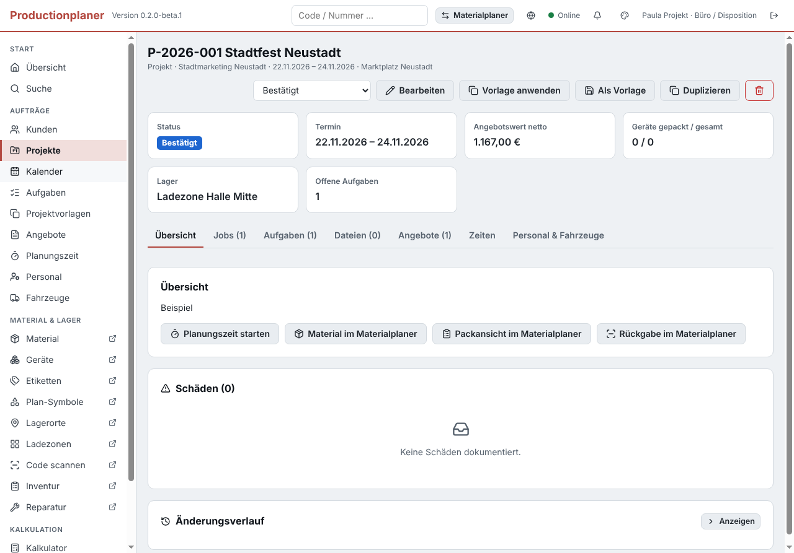
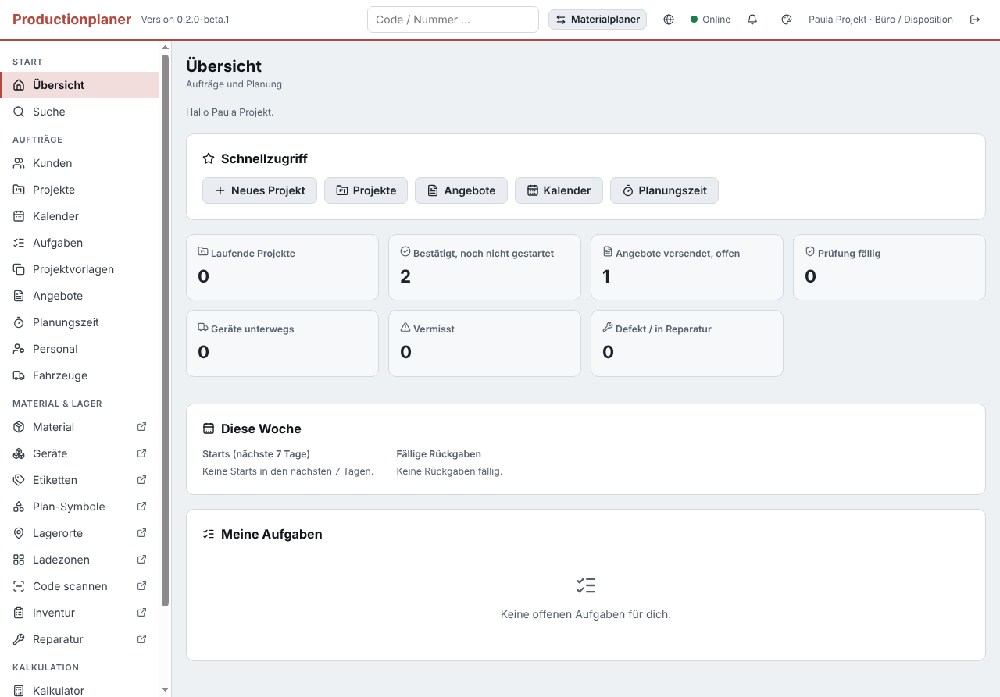
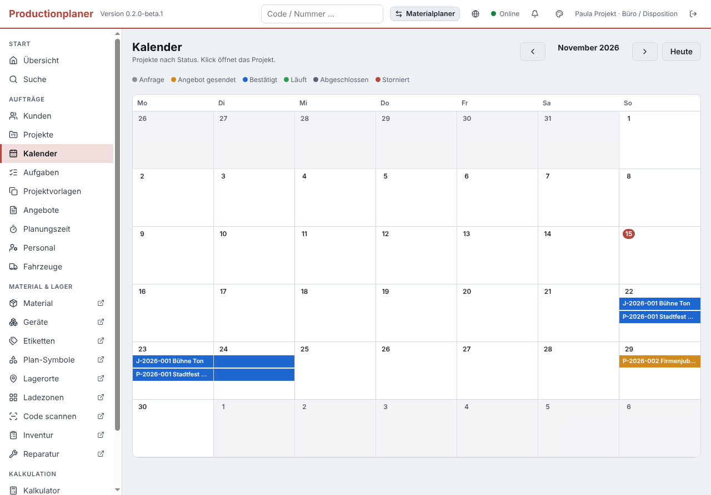
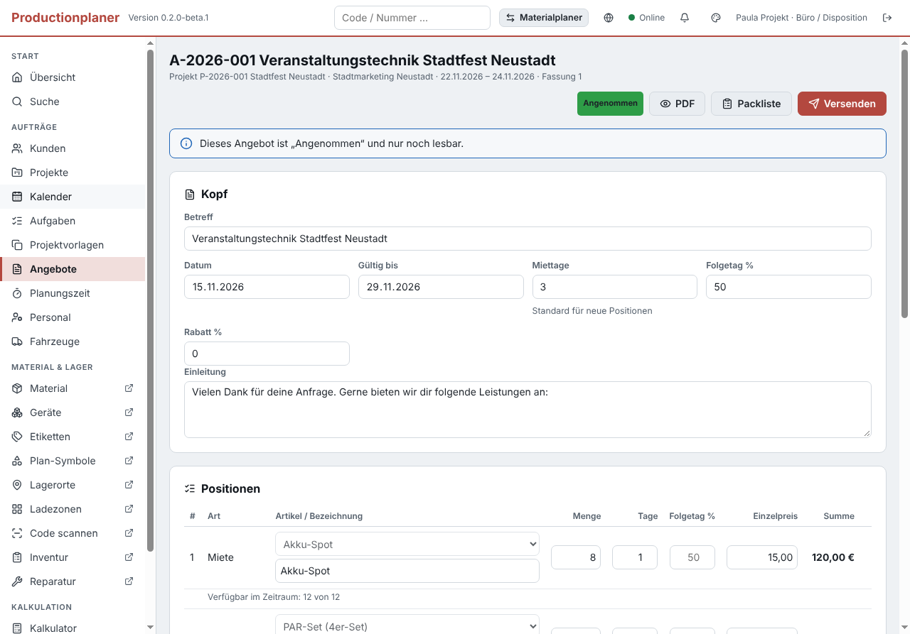
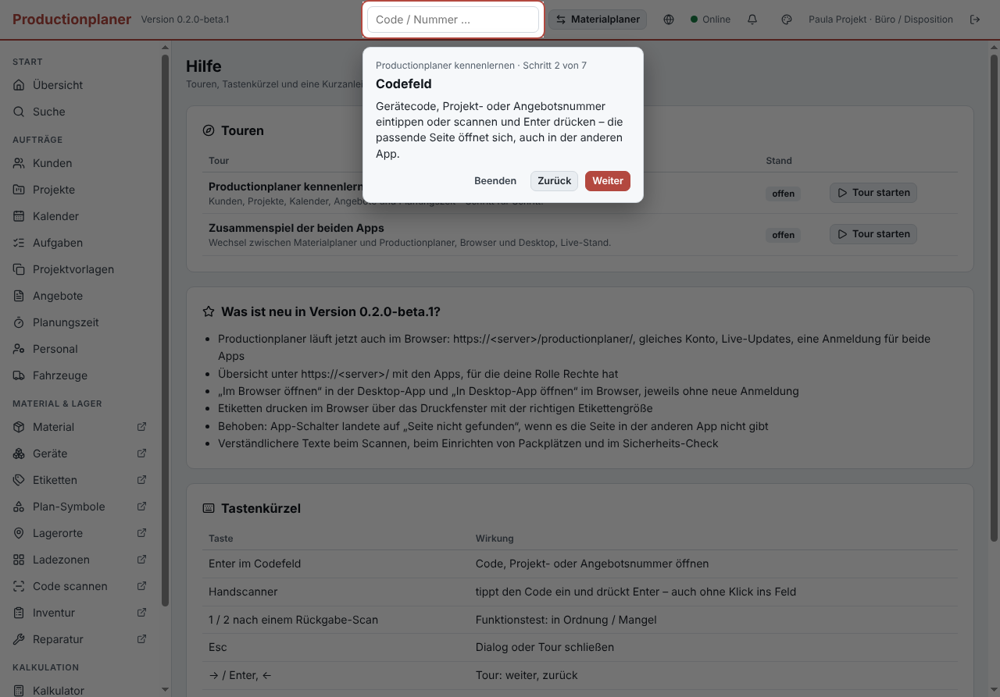

# Productionplaner

Aufträge und Planung für Verleih- und Eventtechnik: Kunden, Projekte und Jobs, Aufgaben, Kalender, Angebote mit Verfügbarkeit und Preisen, Planungszeit, Personal und Fahrzeuge. Teil der Planer-Familie; arbeitet mit dem [Materialplaner](https://github.com/Nomisimo/Materialplaner) zusammen (ein Konto, Live-Updates, Sprünge an die passende Stelle).

Desktop-App für **Windows und macOS** und dieselbe Oberfläche **im Browser** unter `https://<server>/productionplaner/`. Alle Daten liegen auf dem zentralen Lager-Server ([Planer-Lager-Core](https://github.com/Nomisimo/Planer-Lager-Core)).

> **Beta.** Download unter [Releases](https://github.com/Nomisimo/Productionplaner/releases): Windows (x64), macOS Apple Silicon und macOS Intel. Die Installer sind nicht mit einem Apple- bzw. Windows-Zertifikat signiert (Mac: ad-hoc).
>
> **Erster Start am Mac:** Ab macOS 15: Systemeinstellungen › Datenschutz & Sicherheit › ganz unten „Dennoch öffnen“. Bis macOS 14 geht auch Rechtsklick › „Öffnen“. **Windows:** SmartScreen › „Weitere Informationen“ › „Trotzdem ausführen“.
>
> **Server-Adresse:** Auf der Anmeldeseite unter „Server: … ändern“ die Adresse des Lager-Servers eintragen (bekommst du vom Admin).



## Funktionen

| Menü | Inhalt |
|---|---|
| **Übersicht, Suche** | Kacheln, diese Woche, meine Aufgaben; Suche über beide Apps |
| **Kunden** | Adresssuche, Dublettenwarnung, Formular-Import, Ansprechpartner, Kontakt-Historie |
| **Projekte** | Projekte und Jobs je Gewerk (übernehmen Kunde, Termin, Ort), Status, Dateien, Schäden, Änderungsverlauf, Präsenz „wer ist gerade hier“ |
| **Kalender** | Alle Projekte als Balken nach Status |
| **Aufgaben** | Fristen, Zuständige, wiederkehrende Aufgaben, Benachrichtigungen (Glocke, E-Mail) |
| **Projektvorlagen** | Standardaufgaben und -positionen für neue Projekte |
| **Angebote** | Positionen mit Verfügbarkeit im Zeitraum, Miettage, Folgetag-Prozent, Rabatt, Fassungen, Versand, PDF, Packliste; „Angenommen“ reserviert das Material fest |
| **Planungszeit** | Timer am Projekt (stoppt beim Wechsel), Auswertung, Nachbuchen, CSV |
| **Personal, Fahrzeuge** | Einplanen mit Konfliktwarnung, Fahrten mit Ladeliste und Gewichtswarnung |
| **Kalkulator, Zeitrechner** | Schnelle Rechnungen ohne Projekt |
| **Verwaltung** (Admins) | Benutzer, Rollen, Einstellungen, Sicherung, Sicherheit, Arbeitsplätze, Scanner |
| **Hilfe** | Touren, Tastenkürzel, Kurzanleitung, „Was ist neu?“ |

Einträge mit Pfeil (Material, Geräte, Code scannen …) öffnen den Materialplaner an der passenden Stelle, ohne neue Anmeldung. Geld wird intern in Cent gerechnet und kaufmännisch gerundet.

**Updates:** Die App zeigt einen Hinweis, wenn auf GitHub eine neuere Version liegt. Klick auf die Versionsnummer oben zeigt „Was ist neu?“.

| | |
|---|---|
|  |  |
|  |  |

## Entwicklung

Der gemeinsame Code (Server, Oberfläche, Electron-Hauptprozess) liegt im Submodule `core/` ([Planer-Lager-Core](https://github.com/Nomisimo/Planer-Lager-Core)).

```bash
git submodule update --init
npm install
LAGER_SERVER_URL=http://localhost:8080 npm start   # Oberfläche bauen, Electron starten (Server aus dem Core: npm run dev:server)
npm test
npm run build:web    # Browser-Version nach dist-web/ (liefert der Server aus)
npm run dist:mac     # .dmg (arm64 + x64)
npm run dist:win     # .exe-Installer (NSIS, x64)
```

Ohne `LAGER_SERVER_URL` fragt die App beim Anmelden nach der Server-Adresse und merkt sie sich im Benutzerordner. E2E-Tests beider Apps laufen im Core (`npm run e2e`).

## Versionen & Release

- Version in `package.json` (SemVer, Betas `0.x.y-beta.n`), immer gleich mit dem Materialplaner. Änderungen je Version in [CHANGELOG.md](CHANGELOG.md); der Abschnitt der laufenden Version erscheint in der App unter „Was ist neu?“.
- **Release:** Version und CHANGELOG in beiden Apps erhöhen, committen, dann unter Actions › Release › „Run workflow“ (oder `gh workflow run release.yml --ref main`). Der Workflow baut Windows x64, macOS arm64 und x64, legt Tag und GitHub-Release mit `latest*.yml` an; Versionen mit Bindestrich werden Vorabversionen.

## Lizenz

Copyright 2026 Nomisimo (Momo). Lizenziert unter der [Apache License 2.0](LICENSE). Siehe auch [NOTICE](NOTICE).
